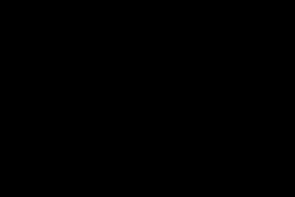
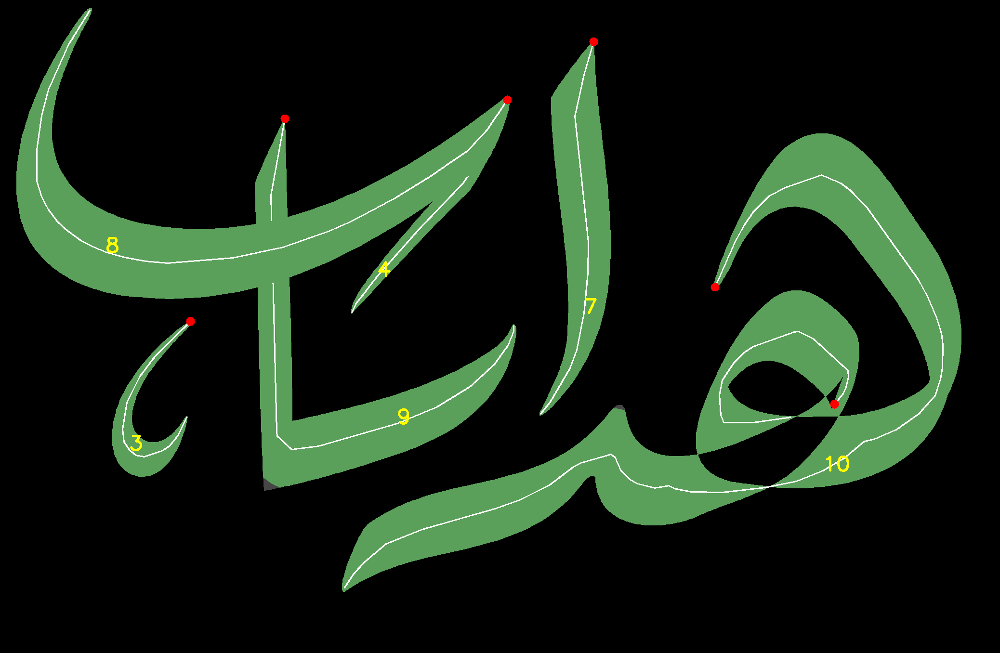

# calligraphy-writeon — تحريك المخطوطات في After Effects

A Claude Code skill that animates an **Arabic calligraphy / lettering logo** in After Effects as if
it is being written with a pen — automatically.

Full-quality result (4K H.264): [`examples/hidayat-writeon.mp4`](examples/hidayat-writeon.mp4)

## What it does
| Step | Script | Result |
|---|---|---|
| 1 | `01_import_split.jsx` | Imports the `.ai` with layers, converts to shapes, one layer per stroke/dot (`Part N`) |
| 2 | `strokes.py` | Rasterises each letter, thins it to a skeleton and finds the **pen's centre line** (adds lines until >98 % of the letter is covered, e.g. the eye of «هـ»); lays out timing in writing order |
| 3 | `02_build_writeon.jsx` | Per-letter matte strokes (Trim Paths → Alpha Matte), a tapered **pen line** running ahead, dot pops, caption reveal, particle bursts |
| 4 | `03_bounce_keys.jsx` | Soft landing bounce as **real keyframes**; reshape one letter, copy it to all |
| 5 | `pdf_text_shapes.py` + `04_text_shapes.jsx` | Rebuilds the Latin caption in the **exact font embedded in the client's PDF** (no font install needed) |
| 6 | `render_mp4.sh` | aerender → plain H.264 MP4 |

How the centre lines were found for the example (red dot = start of each pen line):

## Requirements
- Adobe After Effects with an **AE-MCP** command-folder bridge (`~/Documents/ae-mcp-commands`).
- Python 3: `numpy`, `opencv-python` (+ `pymupdf`, `fontTools` for the caption step).
- Claude Code: put this folder in `~/.claude/skills/calligraphy-writeon/` — see `SKILL.md`.

## Credits
Technique (matte strokes + leading pen line) from the Arabic tutorial
«تحريك مخطوطة الريشة | Lettering Animation» — https://youtu.be/OKKmAb9e1nA .
Automation, skeleton-based stroke planning and scripts: this repo.
The «هدايات» logo in `examples/` belongs to its owner and is shown only as a demo.

MIT License (code only).
